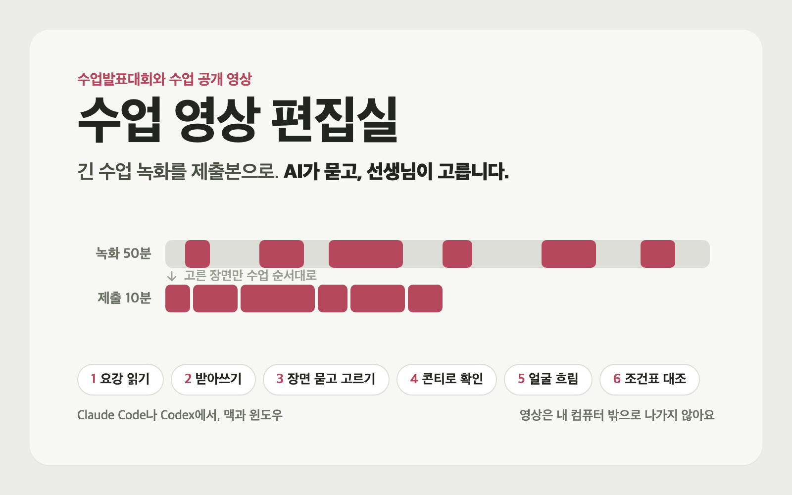

# 수업 영상 편집실 — 긴 수업 녹화본을 대회 제출용 영상으로

수업발표대회나 수업 공개에 낼 영상을 만들 때, 40~50분짜리 수업 녹화본을 **10분 안팎으로 줄이고 대회가 정한 길이, 확장자, 용량에 맞춰 주는** 도구예요.
선생님이 쓰시는 AI(Claude Code, Codex)에게 이 폴더를 열어 주면, AI가 대회 요강을 읽고 선생님께 물어 가며 남길 장면을 함께 고른 뒤 영상을 만들어요.



도름스 소개 글: https://dorms.school/apps/469ee1df-1681-40a5-ac43-5fb69fda200a

## 이렇게 일해요

```
영상 넣기 → 대회 조건표 → 받아쓰기 → 수업 단계 나누기 → 남길 장면 고르기(질문과 답) → 콘티 작업실에서 확인 → 시안 → 제출본
```

| 단계 | AI가 하는 일 | 선생님이 하는 일 |
|---|---|---|
| 영상 넣기 | 구글 드라이브 링크로 받거나 폴더에 넣은 파일을 읽어요. 나뉜 파일은 순서대로 이어요 | 링크나 파일을 줘요 |
| 대회 조건표 | 요강(PDF, HWP)을 읽고 길이, 확장자, 용량, 자막과 편집 규정을 표로 만들어요 | 표가 맞는지 확인해요 |
| 받아쓰기 | 말소리를 이 컴퓨터 안에서 글로 받아써요 | 기다려요(10~30분) |
| 수업 단계 | 지도안이 있으면 그 단계로, 없으면 받아쓴 글로 도입, 전개, 정리를 나눠요 | 경계가 맞는지 확인해요 |
| 남길 장면 | 받아쓴 글에서 후보 장면을 시각과 함께 보여 주고 물어요 | 고르고 답해요 |
| 확인 | 남길 장면을 [콘티 작업실](https://n-lifescience.github.io/conti-studio/) 파일로 만들어요 | 컷마다 영상을 보고 「고쳐 주세요」를 누른 뒤 「빼 줘」, 「앞 10초 더」를 적어요 |
| 시안, 제출본 | 학생 얼굴을 흐리고, 수업 단계 꼬리표와 원래 수업 시각을 얹고, 조건표대로 내보낸 뒤 조건표와 대조해요 | 시안을 처음부터 끝까지 봐요 |

- **장면을 고르는 기준은 AI가 혼자 정하지 않아요.** 선생님 수업에서 무엇을 보여 줄지는 선생님이 답해요.
- 편집은 기본으로 **수업 순서 그대로, 배속 없이** 이어요. 화면 구석에 「수업 18:20」처럼 원래 시각이 떠서 어디를 줄였는지 숨기지 않아요. 요강이 허락할 때만 말소리 없는 구간을 빨리 감을 수 있어요.
- 해설을 넣고 싶으면 [TTS 작업실](https://github.com/N-lifescience/tts-studio)로 내 목소리 해설을 녹음해 얹을 수 있어요. 대회가 해설을 막기도 하니 요강부터 봐요.

## 처음 설치 (한 번만)

### 맥

[Homebrew](https://brew.sh)가 있어야 해요.

```bash
git clone https://github.com/N-lifescience/class-video-studio.git
cd class-video-studio
./setup
```

파이썬 환경, ffmpeg, 얼굴 찾기 모델까지 설치해요. 받아쓰기 모델(약 1.5GB)은 처음 받아쓸 때 저절로 내려받아요.

### 윈도우 10·11

1. [저장소 ZIP](https://github.com/N-lifescience/class-video-studio/archive/refs/heads/main.zip)을 받아 풀거나 `git clone`
2. 폴더 안 **`setup.bat`** 더블클릭 → 파이썬, ffmpeg, 패키지, 얼굴 찾기 모델을 설치해요

| 컴퓨터 | 받아쓰기 | 50분 수업 받아쓰기(대략) |
|---|---|---|
| 애플 실리콘 맥(M1 이상) | whisper large-v3-turbo (MLX) | 5~10분 |
| 윈도우 + NVIDIA 그래픽카드 | whisper large-v3-turbo | 5~10분 |
| 그래픽카드 가속 없는 노트북 | whisper small (조금 덜 정확) | 20~40분 |

설치가 잘 됐는지는 이렇게 봐요.

```bash
.venv/bin/python tools/cvs.py doctor
```

윈도우는 `.venv\Scripts\python.exe tools\cvs.py doctor` 예요.

## 쓰는 법

1. Claude Code(또는 Claude 데스크톱 앱의 Code 탭)나 Codex에서 **이 폴더를 열어요.**
2. 이렇게 말해요.

> 수업발표대회에 낼 수업 영상 편집해 줘. 영상은 이 링크야: https://drive.google.com/… 요강은 바탕화면의 「2026 수업발표대회 공문.pdf」야.

AI가 [`.claude/skills/class-video/SKILL.md`](.claude/skills/class-video/SKILL.md)의 순서대로 일해요. 조건표를 확인할 때, 남길 장면을 고를 때, 시안을 볼 때는 AI가 멈추고 물어봐요.

작업 파일은 `작업/<영상 이름>/` 에 쌓여요. 완성본은 그 안의 `out/` 에 있어요.

```
작업/2026 수업발표대회/
  원본/      받은 수업 영상
  요강/      공문, 요강
  지도안/    수업 지도안(있으면)
  plan/      조건표, 받아쓰기, 수업 단계, 편집안
  conti/     콘티 작업실이 여는 파일
  out/       시안, 제출본, 점검 결과
```

## 구글 드라이브 링크로 넣을 때

링크로 받으려면 드라이브에서 공유를 잠깐 **「링크가 있는 모든 사용자」**로 바꿔야 해요. 학생이 나오는 영상이니 **받은 뒤에 바로 「제한됨」으로 돌려 주세요.** AI도 받은 뒤에 다시 알려 드려요.
번거로우면 드라이브에서 직접 내려받아 `원본/` 폴더에 넣어도 돼요.

## 개인정보

- 영상, 받아쓰기, 얼굴 찾기는 모두 **선생님 컴퓨터 안에서** 돌아요. 이 도구는 서버나 로그인이 없고 아무것도 모으지 않아요.
- 다만 선생님이 쓰시는 AI 서비스(Claude, Codex)에는 **받아쓴 글과 AI가 여는 점검 그림**이 전송돼요. 그래서 AI는 원본 화면을 열지 않고, 화면 전체를 굵게 모자이크한 점검 그림만 봐요. 학교의 동의 절차와 그 AI 서비스의 정책을 먼저 확인해 주세요.
- 자세한 것은 [PRIVACY.md](PRIVACY.md)에 있어요.

## 아직 안 되는 것

- 카메라 여러 대로 찍은 영상을 소리로 맞춰 번갈아 보여 주기(지금은 한 대, 나뉜 파일은 이어 붙이기만)
- 자막 넣기(대회가 자막을 요구하면 받아쓴 글로 SRT를 만들어 드릴 수는 있어요)
- 얼굴 흐림은 정면 얼굴을 잘 찾지만, **옆얼굴이나 아주 작은 얼굴은 놓칠 수 있어요.** 대회가 학생 얼굴을 알아볼 수 없게 하라고 하면 학생이 앉은 칸을 통째로 흐리는 방법(`blur_cells`)을 함께 쓰세요. 카메라가 고정이면 이쪽이 가장 확실해요. 점검 단계에서 의심 시각을 알려 드리지만, 제출 전에는 꼭 처음부터 끝까지 직접 봐 주세요.

## 고쳐 쓰기

선생님 학교와 대회에 맞게 고쳐 쓰셔도 돼요. 쓰던 AI에게 이 폴더를 열어 주고 바꾸고 싶은 것을 말하면 돼요.

```bash
.venv/bin/python -m unittest discover -s tools/tests    # 가짜 영상으로 도는 시험
```

시험은 설치(`./setup` 또는 `setup.bat`)를 마친 뒤에 돌려요. 얼굴 찾기 모델이 `models/`에 있어야 해요.

## 함께 쓰는 도구

- [콘티 작업실](https://n-lifescience.github.io/conti-studio/) — 남길 장면을 컷마다 영상으로 보며 고치는 웹앱이에요(설치 없음, 크롬, 엣지, 웨일)
- [TTS 작업실](https://github.com/N-lifescience/tts-studio) — 내 목소리로 해설을 녹음해요

## 이용 범위

비영리 목적이라면 자유롭게 가져다 쓰셔도 돼요. 다른 곳에 다시 올리거나, 고쳐서 나누거나, 영리 목적으로 쓰실 때는 먼저 연락해 주세요 — [LICENSE](LICENSE).
이 도구로 만든 영상은 모두 만드신 선생님의 것이에요.

문의: GitHub 이슈 또는 인스타그램 [@n_life_science](https://www.instagram.com/n_life_science/)
